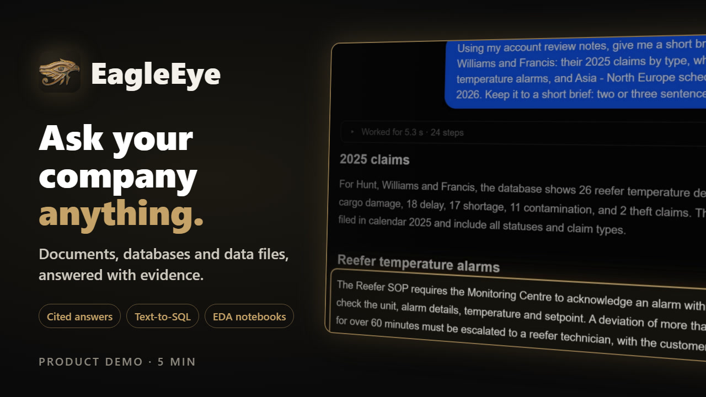
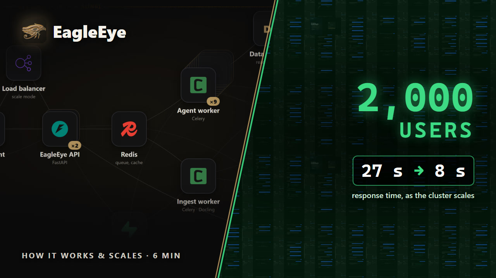
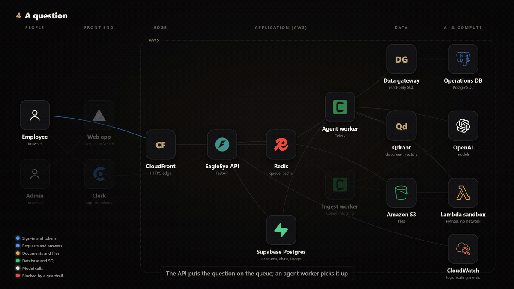

<div align="center">


# EagleEye

**An enterprise AI assistant that answers from your company's documents, databases and data files, with evidence.**

[](https://eagleeye-z85t.vercel.app/demo)
[](https://www.youtube.com/watch?v=_pjZODEwXyk)
[](https://www.youtube.com/watch?v=klPBlEWFGSM)


[Live demo](https://eagleeye-z85t.vercel.app/demo) ·
[Videos](#videos) ·
[Architecture](#architecture) ·
[Getting started](#getting-started) ·
[Documentation](docs/README.md) ·
[Load test report](docs/load-test-report.md)

</div>

---

## Overview

EagleEye gives employees one place to ask questions about their organisation and get answers they
can verify. A single question can draw on enterprise documents, the operational database and the
user's own spreadsheets; every answer shows its sources, the SQL it ran and the steps it took, and
every figure is checked against the underlying results before it is shown.

It is built as a production-style system: role-based access enforced in code at every data
boundary, layered guardrails, an isolated analysis sandbox, a full admin console, infrastructure as
code, and a load test to 2,000 concurrent users with autoscaling.

> **Demo data.** The live demo runs on *Grand Line Shipping Company*, a fictional container shipping
> line with a 12.6-million-row operations warehouse, about 400 policy and operations documents and
> analysis-ready data files, all generated to agree with one another.

## Key features

| | |
|---|---|
| **Cited document answers** | Hybrid retrieval (vectors + full text, fused and reranked) over enterprise and personal documents. PDFs are parsed with Docling, including tables and charts, which a vision model describes. Every claim links to the passage it came from, opened and highlighted in a built-in viewer. |
| **Questions over databases** | Text-to-SQL with a semantic catalog. Generated SQL is validated on its syntax tree (one read-only `SELECT`, granted tables only, personal data masked by role) and re-validated by a separate data gateway before it runs. Results come back as a table with the SQL alongside. |
| **Analysis and charts** | Upload CSV or Excel files for an automatic profile, then ask analysis questions that combine them with the database. Model-written Python or SQL runs in a sandbox with no network access; charts are drawn from the result table, never from model-invented numbers. |
| **Exploratory notebooks** | Ask for a full exploration of a data file and get a step-by-step notebook, with each step explained and executed in the sandbox. |
| **Transparent reasoning** | A live step panel shows the safety check, routing, retrieval, tool calls and checks as they happen, with timings. Answers stream word by word and can be stopped at any time. |
| **Guardrails** | A rules layer and a model-based safety check screen every message (prompt injection, jailbreaks, data exfiltration, credential fishing, harmful requests), plus SQL validation, an output filter and a security-event log. |
| **Admin console** | Usage, cost, latency and quality dashboards (by the minute, live), user management, safety events, content management, service health, budgets and kill switches. |
| **Built to scale** | Stateless API and queue-driven workers on ECS Fargate that scale on answers in progress. Tested to 2,000 concurrent users with 99.99% of answers succeeding. |

## Videos

<table>
  <tr>
    <td width="50%" align="center">
      <a href="https://www.youtube.com/watch?v=_pjZODEwXyk">
        
      </a>
      <br />
      <b><a href="https://www.youtube.com/watch?v=_pjZODEwXyk">Product demo</a></b> · 5 min
      <br />
      <sub>Cited answers, database questions, cross-source analysis, notebooks and guardrails.</sub>
    </td>
    <td width="50%" align="center">
      <a href="https://www.youtube.com/watch?v=klPBlEWFGSM">
        
      </a>
      <br />
      <b><a href="https://www.youtube.com/watch?v=klPBlEWFGSM">How it works, and how it scales</a></b> · 6 min
      <br />
      <sub>The animated architecture, then a recorded load test to 2,000 users.</sub>
    </td>
  </tr>
</table>

## Architecture

<p align="center">
  
  <br />
  <sub>A question's path through the system, from the architecture video. The full map: <a href="docs/assets/architecture.png">static diagram</a>.</sub>
</p>

A question is accepted by the API and placed on a queue, so the API stays responsive under load.
An agent worker picks it up and runs it through a graph:

1. **Safety check.** Rules and a fast model classify the message; unsafe input stops here and is
   logged.
2. **Routing.** Simple questions are answered directly; document questions go to retrieval; anything
   needing data goes to a supervisor that plans tool calls.
3. **Tools, in parallel.** Document search (Qdrant and pgvector), database questions through the
   read-only data gateway, notebook and data analysis in the sandbox, and chart building.
4. **Writing and checks.** The answer is written from the tool results only. Citations are verified,
   every number is checked against the evidence, and the output filter runs.
5. **Streaming.** Steps and answer text stream to the browser over server-sent events.

| Layer | Components |
|---|---|
| Front end | Next.js 15 (React 19) on Vercel, Clerk for sign-in |
| Edge | Amazon CloudFront (HTTPS, origin verification) |
| Application | FastAPI API, Celery agent and ingest workers, Redis (queue and cache), data gateway |
| Data | Supabase Postgres with pgvector (accounts, chats, usage, catalog), Qdrant (enterprise vectors), Amazon S3 (files), PostgreSQL operations warehouse |
| AI and compute | OpenAI models through LiteLLM (fast and capable tiers, with fallbacks), Docling, AWS Lambda analysis sandbox |
| Operations | CloudWatch logs and metrics, ECS Fargate autoscaling, Terraform, GitHub Actions |

Design documents: [High-level design](docs/01-HLD.md) · [Low-level design](docs/02-LLD.md) ·
[Decision log](docs/99-decision-log.md).

## Getting started

### Prerequisites

- Docker Desktop, Node.js 20+ and [uv](https://docs.astral.sh/uv/)
- A [Clerk](https://clerk.com) application (B2B) and an OpenAI API key

### Run locally

```bash
cp .env.example .env   # set NEXT_PUBLIC_CLERK_PUBLISHABLE_KEY, CLERK_SECRET_KEY, OPENAI_API_KEY

# 1. Infrastructure (Redis, Qdrant, SeaweedFS, operations warehouse) and the sandbox image
docker compose -f infra/docker-compose.yml up -d
docker build -t eagleeye-sandbox:1 infra/sandbox

# 2. Local Supabase (Postgres + pgvector) and migrations
npm install
npx supabase start
npx supabase migration up

# 3. API
uv sync --all-packages
uv run --package eagleeye-api uvicorn app.main:app --app-dir apps/api --port 8000

# 4. Agent worker (new terminal)
uv run --package eagleeye-agent-worker celery -A agent_worker.celery_app worker --pool=threads --concurrency=8 -Q agent -l info -n agent@%h

# 5. Ingest worker (new terminal; --pool=solo is required on Windows)
uv run --package eagleeye-ingest-worker celery -A ingest_worker.celery_app worker --pool=solo -Q ingest -l info -n ingest@%h

# 6. Operations warehouse, catalog onboarding and the data gateway (new terminal)
uv run --no-project --with numpy==2.1.3 --with pandas==2.2.3 --with faker==33.1.0 --with asyncpg==0.30.0 python infra/warehouse/generate.py --if-empty
uv run --package eagleeye-catalog python -m eagleeye_catalog.cli onboard grandline_ops
uv run --package eagleeye-data-gateway uvicorn gateway.main:app --app-dir apps/data-gateway --port 8100

# 7. Web app
cd apps/web && npm install && npm run dev
```

Open <http://localhost:3000> and sign in. `/status` shows the live health of every service.

### Accounts and roles

There is no self-sign-up: only people an administrator adds can sign in. Set the first
administrator in the database (`UPDATE users SET role = 'admin' WHERE email = …`); after that,
administrators add people from **Admin console → Users**, one at a time or from a CSV. Roles decide
data access: `member` sees operational data without personal fields, `data_admin` and `admin` see
personal fields and HR tables, and `admin` has the console.

### Demo data

```bash
# Operations warehouse: about 12.6M rows (~6 min)
uv run --no-project --with numpy==2.1.3 --with pandas==2.2.3 --with faker==33.1.0 --with asyncpg==0.30.0 python infra/warehouse/generate.py
# Document library: ~400 files (about $0.15 of model use, cached afterwards)
uv run --package eagleeye-ingest-worker python data/grandline/make_docs.py
# Data files for the analysis features
uv run --package eagleeye-datasets --with pandas==2.2.3 --with numpy==2.1.3 python data/grandline/make_files.py
# Load the documents as enterprise documents (ingest worker running)
uv run --package eagleeye-api python data/grandline/load_docs.py
```

Generated output is written to `data/grandline/out/` and is not committed. Sources of the real
public material used (fuel prices, shipping regulations) are listed in `data/public/SOURCES.md`.

## Deployment

The public demo runs on AWS and Vercel, defined in Terraform under `infra/terraform/`:

- **Demo mode.** The web app on Vercel; the API behind CloudFront on a single EC2 instance running the
  same container image, which **starts on demand and stops when idle**; analysis code in a Lambda
  sandbox with no internet access; Supabase, Qdrant Cloud and S3 for data. Standing cost is about
  $5 a month.
- **Scale mode.** The same image on ECS Fargate behind a load balancer, with autoscaling on answers
  in progress per worker (`infra/terraform/scale/`). Used for the load test and destroyed after it.

Pushing to `main` runs CI; on success, the deploy workflow builds and publishes the images and
updates the running stack. Setup and operations are described in the
[cloud plan](docs/phase7-cloud-plan.md) and [ADR-33](docs/99-decision-log.md).

## Performance

Measured on the scale stack with 2,000 concurrent users
([full report](docs/load-test-report.md)):

| | |
|---|---|
| Answers served | 15,417 in 23 minutes |
| Success rate | 99.99% (2 failures) |
| Response time | average 12.6 s, p95 29.9 s |
| Autoscaling | 1 → 11 agent workers, 1 → 4 API tasks |
| Recovery after a load step | 27.0 s → 7.7 s within two minutes (500 users) |

For the load test the language model was simulated; every other component ran as in production.

## Quality and evaluation

| Evaluation | Result |
|---|---|
| Text-to-SQL golden set (52 questions) | 96% execution accuracy, all 5 refusal cases refused, p50 2.4 s |
| Retrieval (150 questions) | recall@5 of 0.87 with the selected chunking |
| Guardrail evaluation | rules and model guard checked against a corpus of attack and benign messages (`evals/guard_corpus.jsonl`) |
| Automated tests | 1,027 Python and 143 web tests |

```bash
uv run pytest -m "not integration"                       # Python tests
cd apps/web && npx tsc --noEmit && npm run lint && npm test   # web type-check, lint, tests
uv run --package eagleeye-agent-worker python evals/sql_eval.py gpt-6-luna        # SQL golden set
uv run --package eagleeye-ingest-worker python evals/retrieval_eval.py --split dev  # retrieval
```

## Security

- **Access control in code.** Roles come from the database, never from the model; document access
  and data access are filtered at retrieval and at the gateway.
- **Read-only data access.** SQL is validated twice (worker and gateway) against an allow-list of
  tables, with personal fields masked by role and a read-only database account.
- **Isolated execution.** Analysis code runs in a sandbox with no network access and strict time and
  memory limits.
- **Defence in depth.** Input guard, output filter, rate limits, budgets, kill switches and an audit
  trail of security events and admin actions.

Review and scan results: [security review](docs/security-review-phase6.md).

## Project structure

```
apps/
  web/              Next.js front end
  api/              FastAPI: auth, REST, run admission, event streaming, admin
  agent-worker/     Celery worker that runs the agent graph (queue "agent")
  ingest-worker/    Celery worker: parse, chunk, embed and index documents (queue "ingest")
  data-gateway/     Internal SQL executor: re-validates and runs read-only queries
packages/
  agents/           Agent graph: guard, router, RAG, supervisor, tools, checks
  retrieval/        Hybrid retrieval with access filtering and fusion
  llm/              Model gateway (tools, fallbacks) and embedders
  sqlsafe/          SQL validator built on the syntax tree
  catalog/          Semantic catalog of the operational data
  datasets/         CSV and Excel ingestion, profiling and table artifacts
  sandbox/          Static checks and executors for analysis code
  charts/           Chart specifications from result tables
  events/           Run event vocabulary and streaming
  core/             Shared configuration, envelopes, storage and service auth
infra/              Docker Compose, Terraform (bootstrap, base, scale), sandbox, warehouse
evals/              Golden sets and evaluation harnesses, load-test scripts
supabase/           Database migrations
docs/               Design documents, decision log, reports
```

## Documentation

| Document | Description |
|---|---|
| [Requirements and scope](docs/00-requirements-and-scope.md) | Goals, functional and non-functional requirements |
| [High-level design](docs/01-HLD.md) | Architecture, flows and technology choices |
| [Low-level design](docs/02-LLD.md) | Service internals, API contract, state machines |
| [Component designs](docs/README.md#components) | Front end, access control, agents, RAG, text-to-SQL, analysis, guardrails and more |
| [Decision log](docs/99-decision-log.md) | Architecture decision records |
| [Load test report](docs/load-test-report.md) | 2,000-user test method and results |
| [Security review](docs/security-review-phase6.md) | Threats, controls and scan results |

## License

This repository does not currently include an open-source license. The code and documentation are
not licensed for reuse without the author's permission.
