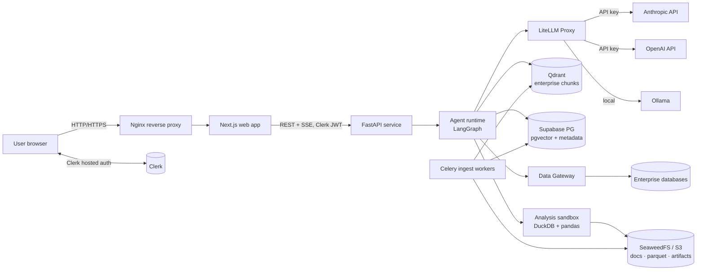
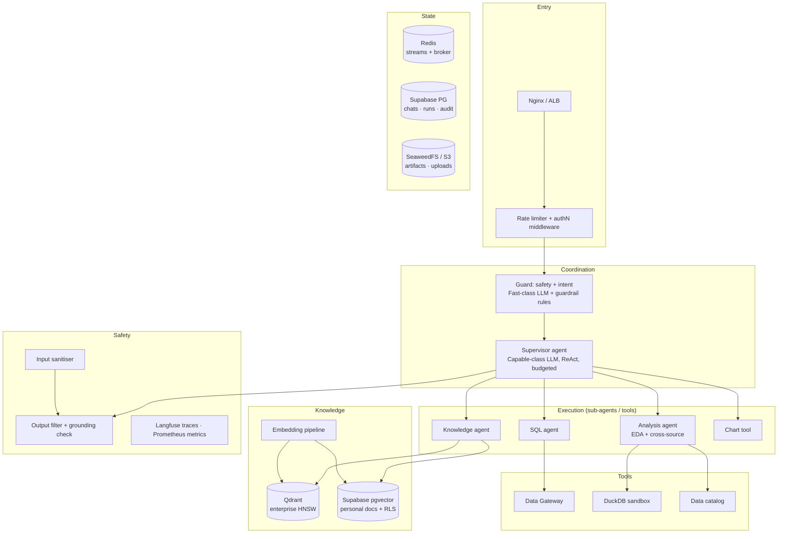
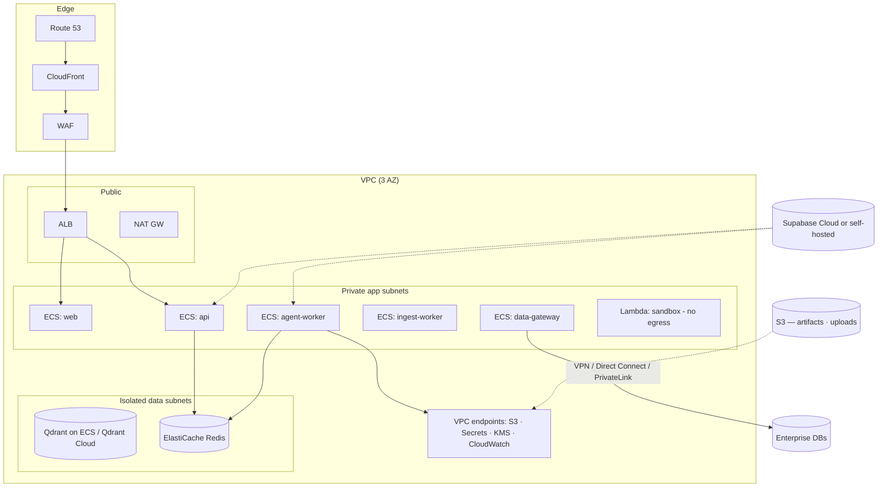

# 01 — High-Level Design (HLD)

> **Phase 1 (current):** Full stack runs locally via Docker Compose — zero cloud cost, complete portfolio demo.
> **Phase 2 (later):** AWS deployment provisioned by Terraform. Architecture is designed so Phase 2 is a configuration change, not a rewrite.

## 1. Architectural principles

1. **Seven layers**: Entry → Coordination → Execution → Knowledge → Tools → State → Safety.
2. **Supervisor-worker** with narrow sub-agents (small prompts, few tools each) rather than one giant agent.
3. **Deterministic where possible**: retrieval pipeline, SQL validation, chart-number verification are code, not prompts.
4. **Defence in depth** for hallucination, injection, and data access. Fail **closed** on safety, fail **soft** on features.
5. **Budgets everywhere**: steps, tool calls, tokens, dollars, seconds.
6. **Stateless compute, shared state** (Redis / Supabase PG / SeaweedFS) so everything scales horizontally.
7. **Provider-agnostic LLM access** via LiteLLM proxy — switch between Anthropic, OpenAI, and Ollama via config.
8. **Local-first** — docker-compose mirrors the production topology; Phase 2 is additive infrastructure, not a redesign.
9. **Every decision has a recorded trade-off** ([99-decision-log](99-decision-log.md)).

## 2. System context



## 3. Layered logical architecture



| Layer | Components | Role |
|-------|-----------|------|
| Entry | Nginx (local) / ALB (cloud), auth middleware, rate limiter | Auth, throttling, spike protection |
| Coordination | Guard, Supervisor | Safety gate, intent routing, planning, budgets |
| Execution | Knowledge, SQL, Analysis sub-agents; Chart tool | Focused workers, each with limited tools |
| Knowledge | Ingestion pipeline, Qdrant (enterprise), Supabase pgvector (personal) | Hybrid retrieval with per-source ACL |
| Tools | Data Gateway, DuckDB sandbox, data catalog | Controlled access to data and compute |
| State | Redis (hot), Supabase PG (truth), SeaweedFS/S3 (files) | Run state, history, artifacts |
| Safety | Guardrail rules, ACL enforcement, Langfuse tracing, Prometheus | Prevent leaks and misuse, enable debugging |

## 4. Technology choices (full trade-offs in ADRs)

| Concern | Phase 1 (local) | Phase 2 (cloud) | ADR |
|---------|----------------|-----------------|-----|
| Auth | **Clerk** (dev mode, no tunnel needed) | Same | ADR-18 |
| Frontend | **Next.js App Router + TypeScript + Tailwind + shadcn/ui** | Same, served via CloudFront | — |
| Backend | **Python 3.12 + FastAPI (async)** | Same on ECS Fargate | — |
| Agent framework | **LangGraph** behind internal ports | Same | ADR-17 |
| LLM access | **LiteLLM proxy** → Anthropic API or Ollama | Same → Anthropic API or OpenAI | ADR-02 |
| LLM tiers | **Fast-class** (Haiku / GPT-4o-mini / small Ollama); **Capable-class** (Sonnet / GPT-4o / large Ollama) | Same | ADR-03 |
| Embeddings | Provider via LiteLLM (OpenAI `text-embedding-3-small`; or Ollama local embed) | Same | ADR-02 |
| Enterprise vector store | **Qdrant** (Docker, port 6333) | Qdrant Cloud or self-hosted ECS | ADR-04 |
| Personal doc vector store | **Supabase pgvector** (Supabase CLI local) | Supabase Cloud or self-hosted | ADR-04 |
| Relational DB | **Supabase PostgreSQL** (Supabase CLI local) | Supabase Cloud or self-hosted | ADR-15 |
| Cache / event bus | **Redis** (Docker) — streams, rate limits, Celery broker | ElastiCache Redis | ADR-15 |
| Async jobs | **Celery + Redis** (workers in docker-compose) | Celery on ECS; optionally SQS as broker | ADR-14 |
| Compute | **Docker Compose** (all services) | ECS Fargate | ADR-16 |
| Code sandbox | **Docker subprocess** (`--network none`, scoped temp volume) | Lambda container, no egress | ADR-10 |
| Cross-source engine | **DuckDB** in worker subprocess | DuckDB in Lambda; Athena for >5M rows | ADR-09 |
| Object store | **SeaweedFS** (S3-compatible, Docker) | S3 | ADR-26 |
| Charts | **Vega-Lite spec** generated by tool, rendered client-side | Same | ADR-11 |
| Observability (LLM) | **Langfuse OSS** (Docker, free) | Langfuse Cloud or self-hosted ECS | ADR-24 |
| Observability (infra) | **Prometheus + Grafana** (Docker, free) | CloudWatch + managed Grafana | ADR-24 |
| IaC / orchestration | **docker-compose.yml** | Terraform + GitHub Actions CI | ADR-25 |

## 5. Core runtime flows

### 5.1 Chat turn (interactive path)

```mermaid
sequenceDiagram
  participant B as Browser
  participant A as API
  participant R as Redis
  participant W as Agent worker (Celery)
  participant L as LiteLLM Proxy
  B->>A: POST /chats/{id}/messages (JWT, text, attached ids)
  A->>A: authN, rate-limit, persist user msg + run row (Supabase)
  A->>R: LPUSH run-requests {run_id}
  A-->>B: 202 {run_id}; open GET /runs/{id}/stream (SSE)
  W->>R: BLPOP claim run
  W->>L: Guard call — fast-class model (safety + intent)
  alt blocked
    W->>R: XADD events refusal; done
  else simple chat
    W->>L: single capable-class answer call
  else data/doc/analysis
    W->>W: Supervisor LangGraph loop (tools, budgets)
  end
  W->>R: XADD events (run, step, text delta, artifact, done)
  A->>R: XREAD events from last-event-id
  A-->>B: SSE events (seq-numbered)
  W->>A: persist assistant msg, steps, usage (Supabase PG)
```

The browser can disconnect and **resume** with `Last-Event-ID`; the run continues in the Celery worker and the result is saved to Supabase.

### 5.2 Document ingestion

`Browser → presigned PUT to SeaweedFS/S3 (SHA-256 dedupe) → upload complete signal → Celery ingest task enqueued in Redis → ingest worker → (malware scan) → parse → chunk → embed → upsert chunks to Qdrant (enterprise) or Supabase pgvector (personal) → mark READY in Supabase`. Status pushed via SSE / polled. Details: [C4](components/C4-rag.md).

### 5.3 Natural-language SQL

`Supervisor → SQL agent → catalog retrieval (relevant tables/columns) → generate SQL → AST validate + permission check → Data Gateway executes (read-only, timeout, row cap) → result stored as artifact (Parquet in SeaweedFS/S3, metadata in Supabase) → summary/insight`. Details: [C5](components/C5-text-to-sql-data-gateway.md).

### 5.4 Cross-source analysis / EDA

`Analysis agent → registers sources as datasets → evaluates join size (small: pandas in-memory; large: DuckDB subprocess) → executes → returns stats + result artifacts → chart spec → grounded narration`. Details: [C6](components/C6-eda-analysis-charts.md).

## 6. Deployment view

### 6.1 Phase 1 — Local (Docker Compose)

All services run on the developer's machine via a single `docker-compose up`. The topology mirrors production so the transition to Phase 2 is a configuration change, not an architectural change.

```
┌─────────────────── docker-compose services ──────────────────────┐
│                                                                    │
│  nginx          ← reverse proxy → web (3000) + api (8000)        │
│  web            ← Next.js (port 3000)                             │
│  api            ← FastAPI REST + SSE (port 8000)                  │
│  agent-worker   ← Celery worker (agent runs, LangGraph)           │
│  ingest-worker  ← Celery worker (parse / chunk / embed)           │
│  data-gateway   ← FastAPI internal (port 8001, no public route)   │
│                                                                    │
│  redis          ← Redis 7 (port 6379)  streams + broker           │
│  qdrant         ← Qdrant (port 6333)   enterprise vectors         │
│  supabase       ← Supabase CLI local   PG + pgvector + Auth       │
│  seaweedfs          ← SeaweedFS (port 8333)    S3-compat object store     │
│                                                                    │
│  langfuse       ← Langfuse OSS (port 3001)  LLM traces + evals   │
│  prometheus     ← Prometheus (port 9090)    infra metrics         │
│  grafana        ← Grafana (port 3002)       metrics dashboards    │
│                                                                    │
│  ollama*        ← Ollama (port 11434)   optional local LLM        │
└────────────────────────────────────────────────────────────────────┘
* ollama profile: docker-compose --profile local-llm up
```

Environment variables in `.env` (gitignored) control `LLM_PROVIDER`, API keys, and feature flags. A `.env.example` documents every variable.

### 6.2 Phase 2 — Cloud (AWS, Terraform)

> Added when ready to deploy. All service names, env-var names, and port conventions are identical; only the backing infrastructure changes.



Cloud-phase changes from Phase 1:
- SeaweedFS → S3; local Redis → ElastiCache; Supabase CLI → Supabase Cloud or self-hosted on EC2
- Nginx → CloudFront + WAF + ALB
- Docker Compose workers → ECS Fargate services (autoscaling: CPU for web/api, Redis queue depth for ingest-worker, active-run count for agent-worker)
- Langfuse OSS → Langfuse Cloud or self-hosted ECS service
- Prometheus/Grafana → CloudWatch + Amazon Managed Grafana

## 7. Scaling & resilience summary

**Phase 1 (local):**
- Celery worker concurrency (`--concurrency N`) controls parallelism.
- All state in Redis + Supabase; workers are stateless — restart any worker without losing runs.
- LangGraph checkpoints in Supabase enable mid-run resume after crash.

**Phase 2 (cloud, additive):**
- ECS autoscaling: CPU for web/api; Redis queue depth for ingest-worker; active-run count for agent-worker.
- ElastiCache Redis cluster mode; Supabase with connection pooler (PgBouncer built-in).
- **Model fallback chain**: capable-class primary → alternate capable-class provider → fast-class (flag `degraded`) → semantic cache → "connect me to support". Never a silent failure.
- Graceful degradation ladder: full (docs+SQL+analysis) → docs only → plain chat → maintenance banner.
- Backpressure: per-user concurrent-run cap (2), per-org LLM API token bucket, Celery task queue depth shedding with clear "busy" message.
- **DR deferred** — not required for portfolio v1; single-region only. Add cross-region Supabase/Postgres replication + S3 CRR when a production SLA demands it.

## 8. Security summary

- Clerk JWT verified at API; `user_id`, `org_id`, `groups` derived server-side; **never** trusted from client or LLM.
- Authorization enforced **below** the LLM: chunk ACL filters in Qdrant and Supabase pgvector, catalog/table grants, Data Gateway read-only roles. The model cannot widen access.
- Enterprise DB credentials exist only in Data Gateway (`.env` / Secrets Manager in cloud); agent workers never see them.
- Sandbox has no network (`--network none` locally; Lambda no-egress in cloud); reads only scoped temp volume or S3 prefix.
- TLS in transit (Nginx TLS locally for demos; CloudFront + ACM in cloud). KMS encryption at rest in cloud.
- Details: [C8](components/C8-guardrails-security.md), [C2](components/C2-auth-and-access-control.md).

## 9. Cross-cutting NFR traceability

| NFR | Mechanism | Doc |
|-----|-----------|-----|
| Latency | Streaming SSE, model tier routing, parallel tool calls, prompt caching, pre-warmed context | C3, C7 |
| Cost | Fast-class routing, semantic cache, per-run budgets, top-k limits, Ollama for free local dev | C3, C10 |
| Reliability | Retry/backoff, loop budgets, model fallback chain, Celery retry + DLQ, LangGraph checkpoints | C3, C10 |
| Security | ACL below LLM, gateway, network-isolated sandbox, guardrail rules, audit log | C2, C8 |
| Quality | Golden sets, LLM-as-judge via Langfuse evals, SQL execution accuracy, feedback loop | C9 |
| Portability | docker-compose ↔ ECS Fargate; SeaweedFS ↔ S3; Celery Redis broker ↔ SQS broker; Supabase CLI ↔ Supabase Cloud | ADR-16, ADR-25 |
