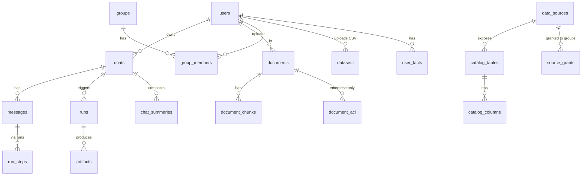

# 03 — Data Model

Primary store: Supabase PostgreSQL 16 (+ `pgvector`, `pg_trgm`) — local via Supabase CLI (Phase 1), Supabase Cloud or self-hosted (Phase 2). Enterprise chunk **embeddings** live in Qdrant (ADR-04); everything else relational lives here. Every table has `id uuid pk`, `created_at`, `updated_at`; `org_id` present for future multi-tenancy (single value in v1).

## 1. Entity overview



## 2. Tables

### Identity & access
| Table | Key columns |
|-------|-------------|
| `users` | `clerk_user_id` (unique), `email`, `display_name`, `role` (`member`,`knowledge_admin`,`data_admin`,`admin`), `status`, `last_seen_at` |
| `groups` | `name`, `clerk_org_role?`, `description` |
| `group_members` | `group_id`, `user_id` |
| `source_grants` | `data_source_id`, `group_id`, `allowed_tables text[]?`, `row_filter_sql?` |

### Chat
| Table | Key columns |
|-------|-------------|
| `chats` | `user_id`, `title`, `summary_version`, `last_message_no`, `archived`, `facts_read_to_msg_no` |
| `messages` | `chat_id`, `msg_no` (monotonic per chat), `role` (`user`/`assistant`), `parts jsonb` (text, citations, artifact refs), `run_id`, `idempotency_key` (unique per chat), `tokens_in/out` |
| `runs` | `chat_id`, `user_id`, `status`, `intent`, `model_ids jsonb`, `usage jsonb`, `cost_usd`, `degraded bool`, `heartbeat_at`, `error_code`, `trace_id` |
| `run_steps` | `run_id`, `parent_step_id`, `seq`, `kind`, `name`, `input jsonb` (redacted), `output_summary`, `status`, `duration_ms`, `tokens`, `cost_usd` |
| `chat_summaries` | `chat_id`, `version`, `covers_up_to_msg_no`, `text`, `tokens` |
| `user_facts` | `user_id`, `key`, `value`, `source_msg_id`, max 20/user (enforced in app + trigger) |
| `feedback` | `message_id`, `user_id`, `rating`, `comment` |

### Knowledge
| Table | Key columns |
|-------|-------------|
| `documents` | `scope` (`enterprise`/`personal`), `owner_id` (null for enterprise), `title`, `filename`, `mime`, `size_bytes`, `sha256`, `s3_key`, `status`, `stage`, `stage_detail jsonb`, `page_count`, `error`, `tags text[]`, unique(`sha256`,`owner_id`) |
| `document_acl` | `document_id`, `group_id` (enterprise docs; no rows = all employees) |
| `document_chunks` | `document_id`, `chunk_no`, `kind` (`text`,`table`,`image`), `content_processed` (embedded text), `content_original` (immutable), `page`, `bbox jsonb`, `heading_path text[]`, `scope`, `owner_id`, `acl_group_ids uuid[]` (denormalised), `embedding vector(D)` (**personal scope only**; D set by `EMBED_MODEL`), `tsv tsvector GENERATED`, `chunk_hash` |

**Dual-store split (ADR-04):** `document_chunks` in Postgres is the system of record for all chunk text/metadata. Personal-scope embeddings are stored in the `embedding` column (pgvector). Enterprise-scope embeddings are **not** stored in Postgres — they live in a Qdrant collection (`enterprise_chunks`), point id = `chunk_id`, payload mirrors `{document_id, acl_group_ids, heading_path, page}` for filtered-ANN; upserts to both are idempotent by `chunk_hash`.

Indexes (Postgres): `HNSW (embedding vector_cosine_ops) WITH (m=16, ef_construction=128)` partial on `scope='personal'`; `GIN (tsv)`; btree `(scope, owner_id)`; GIN `(acl_group_ids)` (see C4 §4).

### Data
| Table | Key columns |
|-------|-------------|
| `data_sources` | `name`, `description`, `engine` (`postgres`,`mysql`,`mssql`,`redshift`…), `host_ref`, `secret_arn`, `status`, `schema_version`, `max_rows`, `timeout_s` |
| `catalog_tables` | `data_source_id`, `schema_name`, `table_name`, `description` (human/LLM-curated), `embedding vector(D)`, `row_estimate`, `sensitivity` (`public`,`internal`,`restricted`), `enabled` |
| `catalog_columns` | `table_id`, `name`, `type`, `description`, `sample_values jsonb` (masked), `is_pk`, `fk_ref`, `pii bool` |
| `catalog_metrics` | `data_source_id`, `name`, `definition_sql`, `description` (semantic layer: "revenue", "active customer") |
| `datasets` | `owner_id`, `scope`, `name`, `origin` (`csv_upload`,`xlsx`,`query_result`,`doc_table`), `s3_parquet_key`, `row_count`, `schema jsonb`, `profile jsonb`, `status` |
| `artifacts` | `run_id`, `user_id`, `type` (`table`,`chart`,`profile`), `title`, `s3_key`/`inline jsonb`, `spec jsonb` (Vega-Lite), `source_refs jsonb` (provenance: SQL, dataset ids), `row_count` |

### Governance
| Table | Key columns |
|-------|-------------|
| `audit_log` (append-only, partitioned monthly) | `actor_id`, `action`, `resource_type/id`, `ip`, `details jsonb`, `trace_id` |
| `usage_ledger` | `user_id`, `run_id`, `model_id`, `tokens_in/out`, `cost_usd`, `day` (feeds quotas/dashboards) |
| `sql_query_log` | `run_id`, `user_id`, `source_id`, `sql_hash`, `sql_text`, `rows`, `duration_ms`, `validated bool`, `rejected_reason` |

## 3. Row-Level Security (backstop)
App sets `SET LOCAL app.user_id`, `app.groups` per transaction. Policies, e.g. on `document_chunks`:
```
scope='personal' AND owner_id = current_setting('app.user_id')::uuid
OR scope='enterprise' AND (acl_group_ids = '{}' OR acl_group_ids && current_setting('app.groups')::uuid[])
```
The retrieval SQL **also** includes these predicates explicitly (RLS = safety net, not the only control; also keeps HNSW filtering planned correctly).

## 4. Object-store layout — SeaweedFS (Phase 1) / S3 (Phase 2) (buckets: `eagleeye-{env}-docs`, `-data`, `-artifacts`; versioning, block public; SSE-KMS in Phase 2)
```
docs/{scope}/{owner_or_ent}/{document_id}/original/{filename}
docs/.../derived/images/{n}.png        # extracted figures
data/{owner_id}/{dataset_id}/data.parquet
data/{owner_id}/{dataset_id}/profile.json
artifacts/{user_id}/{run_id}/{artifact_id}.{parquet|json|png}
sessions/{session_id}/…                 # sandbox scratch, 1-day lifecycle
```
Lifecycle: sandbox scratch 1 day; artifacts 90 days (configurable); deleted-document objects purged async (queue), audit retained.

## 5. Redis keys
| Key | Type | TTL | Purpose |
|-----|------|-----|---------|
| `run:{id}:events` | Stream | 1 h after done | SSE source, resume |
| `run-requests` | Stream + consumer group | — | Dispatch to agent workers |
| `run:{id}:cancel` | String | 10 min | Cancel flag |
| `ctx:{chat}:{fv}:{mn}` | String | 15 min | Prebuilt prompt prefix |
| `uctx:{user}` | Hash | 60 s | User context cache |
| `rl:*` | counters | window | Rate limits |
| `sem:{scope_hash}:{emb_bucket}` | Hash | 6 h | Semantic cache |
| `lock:*` | String NX | short | Compaction, fact extraction, sweeper |

## 6. Migrations
Alembic, forward-only in prod, expand/contract pattern for zero-downtime; embeddings dimension change = new column + backfill job + swap.
