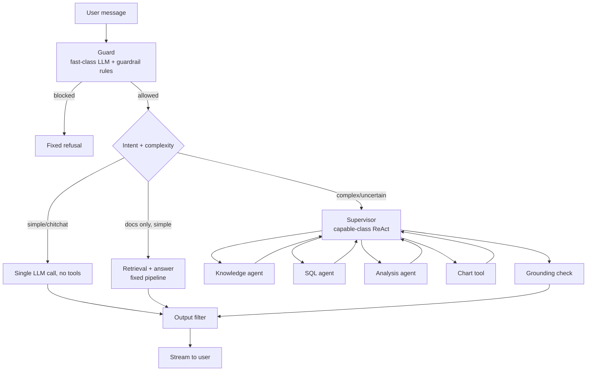

# C3 — Agent Orchestration

## 1. Pattern
**Guard → Router → Supervisor-worker**, per the playbook: cheap model classifies/guards; a stronger model plans and calls specialised sub-agents; deterministic code does retrieval, validation, and verification. Sub-agents are used instead of one mega-prompt because tools, prompts, and failure modes differ (docs vs SQL vs analysis) and each prompt stays small (< 1.5k tokens).

## 2. Components

### 2.1 Guard (first step on every message; fails closed)
One structured call (fast-class LLM, temp 0) returning JSON:
`{safe: allowed|harmful|prompt_injection|sensitive_exfiltration|uncertain, intent: chitchat|docs|sql|analysis|mixed|other, complexity: simple|complex|uncertain}` plus configurable guardrail rules (prompt-attack regex patterns, denied-topic list, PII detection). Blocked → fixed refusal (does **not** reveal detection logic), security event logged. If the guard is down or JSON invalid after one retry → **block with "temporarily unavailable"** (fail closed). Input sanitiser strips known injection patterns first (cheap regex layer).

### 2.2 Router
Rule-based over Guard output plus attachments/selection state:
- `chitchat` → single call; `docs`+simple → fixed RAG pipeline (one rewrite call + one answer call; fastest/cheapest path, expected ≥ 50% of traffic); everything else/uncertain → Supervisor.

### 2.3 Supervisor (ReAct loop)
- Model: capable-class (configured via `MODEL_CAPABLE` env var). Tools = the sub-agents/tools in LLD §3.3, exposed as typed functions.
- Prompt = ordered for **prompt caching**: `[role + rules] [tool schemas] [user facts] [chat summary] [current time] [recent messages] [tool memory/results]` (static first).
- Plans briefly (visible as a step), calls independent tools **in parallel** (e.g., `search_knowledge` and `describe_tables`), then synthesises.
- Hard budgets (config, checked before each LLM call): `max_steps 14`, `max_tool_calls 12`, `max_cost $0.25`, `max_seconds 120` (240 analysis). On breach: stop, produce best partial answer with disclosure, mark `BUDGET_EXCEEDED`.
- Loop detection: identical tool+args twice → forced different strategy hint; third → terminate.

### 2.4 Sub-agents
| Agent | Prompt scope | Tools | Output |
|-------|--------------|-------|--------|
| Knowledge | Answer only from retrieved chunks, cite `[n]`, say "not found" when low relevance | `search_knowledge` | Answer fragment + citations |
| SQL | Write one read-only query using provided catalog slice; self-correct on error (max 3) | `describe_tables`, `run_sql` | Artifact (table) + SQL + explanation |
| Analysis | Plan EDA/join with DuckDB or pandas; produce stats and tables | `get_dataset_profile`, `analyze_data` | Artifacts + stats JSON |
| Chart (tool, not LLM-first) | Map intent → chart type/encodings; **verified against data** | `make_chart` | Vega-Lite spec |

Sub-agents run as nested graph nodes with their own smaller budgets (e.g., SQL: 4 LLM calls, 3 executions) and emit `step.*` events with `parent_id` for the UI step tree.

### 2.5 Grounding check (deterministic + optional LLM-judge)
- **Numbers**: every numeric literal in a chart spec or insight sentence must appear in a tool result/artifact (tolerance for rounding/derived stats computed by the sandbox). Violation → one corrective retry ("use only values from tool results"), else drop the claim/chart and disclose.
- **Citations**: `[n]` must map to a retrieved chunk; uncited factual doc claims flagged.
- **Optional** fast-class LLM judge on a sampled/high-risk subset (cost-bounded).

### 2.6 Output filter
PII/secret scan (regex + optional fast-class LLM scan), system-prompt leakage check, ACL sanity (citations only from permitted docs — assertion), markdown sanitisation. Failure → regenerate once with guidance, else safe fallback message.

## 3. Model routing & fallback
| Task | Primary | Fallback |
|------|---------|----------|
| Guard, router, query rewrite, title generation, summarisation | fast-class (`MODEL_FAST`) | Alternate fast-class or provider fallback |
| Supervisor, SQL, analysis, final answer | capable-class (`MODEL_CAPABLE`) | Alternate capable-class → fast-class (flag `degraded`) |
| Embeddings | Provider embed model (`EMBED_MODEL`, e.g. `text-embedding-3-small` or `nomic-embed-text`) | Alternate embed model for query-side only if index compatible (else fail soft to keyword-only search) |
`LLMGateway` (LiteLLM adapter) handles retries (429/5xx, backoff 1/2/4 s), circuit breaker (open after 5 failures/30 s → half-open probes), per-model concurrency semaphores, token-bucket vs provider rate limits, and records usage/cost.

## 4. Failure scenarios (from playbook, adapted)
| Scenario | Handling |
|----------|----------|
| Tool timeout (SQL gateway) | Retry once (2 s); then say what failed, offer to retry or narrow the question; never fabricate data |
| Low retrieval relevance (< threshold) | Answer "couldn't find in your documents", optionally general guidance flagged as such; suggest uploading/adjusting scope |
| Reasoning loop | Loop budget → forced termination with partial answer + trace |
| Prompt injection (in message or in doc/DB content) | Guard + `<tool_data>` isolation + no write tools; log; neutral response |
| LLM provider throttled | Queue briefly (≤ 3 s) → fallback model → degraded answer; UI shows banner |
| SQL returns 0 rows | Agent reports honestly, suggests filters check (distinct values lookup tool) |
| Wrong/ambiguous question | Agent **asks one clarifying question** rather than guessing (esp. ambiguous metric/date range) |

## 5. Streaming & persistence
All nodes write to one **event sink** (single writer per run → gapless `seq`) → Redis Stream. On finish: persist assistant `messages.parts`, `run_steps`, `usage_ledger`, `sql_query_log`. LangGraph checkpoints (Supabase PG checkpoint saver) enable resume after worker crash at node boundaries.

## 6. Prompts governance
Prompts live in `packages/agents/prompts/*.md`, versioned, reviewed like code; each has an eval set; prompt version id recorded on every run/trace. Instruction hierarchy: system > developer rules > user; tool data = untrusted data.

## 7. Idempotency & concurrency
Run keyed by `(chat_id, idempotency_key)`; only one active run per chat (409 otherwise, or queued); per-user max 2 concurrent runs. All tools used are read-only → inherently safe to retry.

## 8. As built — Phase 3 (local)

| Area | Implemented | Deferred |
|------|-------------|----------|
| Execution | `apps/agent-worker` (Celery queue `agent`, thread pool → one shared loop, ADR-28); API admits, enqueues, streams | Checkpoint/resume |
| Graph | `packages/agents`: LangGraph `guard → {blocked \| simple \| rag \| rag_auto \| supervisor ⇄ tools} → finalize` | Nested sub-agent graphs (with SQL, Phase 4) |
| Guard | Regex layer (injection, exfiltration, denied topics, NFKC + zero-width stripping) → fast-tier JSON classifier, strict parse, 1 retry, **fail closed**; neutral refusal; blocked input stored in `security_events` | PII anonymisation |
| Router | Pure table: selection → rag; chitchat → simple; docs+simple → rag; other+simple → rag_auto (ground only above `RAG_MIN_SCORE`); else supervisor | — |
| Supervisor | Capable model with typed tools `search_knowledge`, `list_documents`; parallel tool calls; `<tool_data>` isolation; run-level `[n]` numbering; budgets (steps 14, tool calls 12, $0.25, 120 s); repeat → hint, 3rd repeat → stop; final no-tool answer with disclosure, status `BUDGET_EXCEEDED` | `run_sql`, `analyze_data`, `make_chart` |
| Authorization | Tools build `AccessScope` from the run's user only; model-supplied `doc_ids` intersected with visible docs | — |
| Checks | Citation grounding (invalid `[n]` stripped, uncited answers flagged); output filter (provider/AWS/Clerk keys, private keys, JWTs, system-prompt lines, `javascript:` links) → `text.replace` + security event | Numeric grounding, LLM judge |
| Control | Stop = Redis flag polled by a watchdog that cancels the graph mid-call (~0.5 s); hard deadline; one active run per chat (unique index + 409); 2 per user (429); stale runs failed on next send | — |
| Records | `run_steps`, `usage_ledger`, `security_events`; `runs.route/guard/degraded/prompt_versions`; message parts `text`, `citations`, `steps`, `run` (UI tree survives reload) | Langfuse traces |
| Resilience | LiteLLM `num_retries=2`, 60 s request timeout, optional `MODEL_*_FALLBACK` → `degraded` | Circuit breaker, semaphores |

**Guard smoke eval** (`evals/guard_smoke.py`, 40 labelled prompts, gpt-4o-mini, 2026-11-12): attacks blocked 16/16 (4 by regex, no LLM call); false positives 0/24; intent accuracy 18/21 (86 %; all misses labelled `other` → auto-RAG, harmless); LLM guard latency p50 1.14 s, p95 1.69 s.

## 9. Open decisions
None — LangGraph confirmed as agent framework (ADR-17 Accepted). Ports/adapters keep future framework changes reversible.
