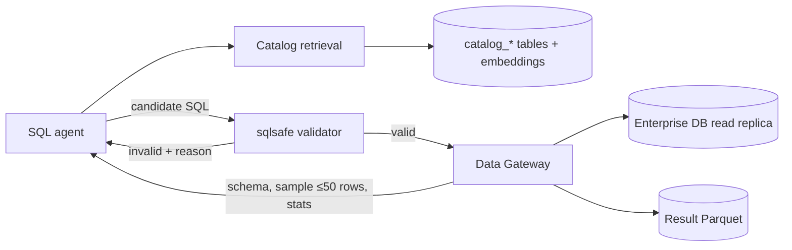

# C5 — Text-to-SQL & Data Gateway

Goal: user asks in natural language; system produces a **correct, safe, permitted, read-only** SQL query on enterprise databases, shows the SQL and result, and explains it.

## 1. Components

## 2. Semantic catalog (the key to accuracy)
Raw schemas alone yield poor SQL. We maintain a **catalog** per data source:
- **Tables & columns** with business descriptions (LLM-drafted at onboarding, **reviewed by data admins**), types, PK/FK, units, enumerations of low-cardinality values (masked if sensitive), sample values.
- **Metrics/definitions** (`catalog_metrics`): "revenue = SUM(net_amount) WHERE status='paid'", "active customer = purchase in last 90 days".
- **Join hints** & **golden example queries** (question → SQL) used as few-shot.
- Embeddings on table/column/metric descriptions for retrieval.
- **Refresh**: nightly job diffs the live schema (information_schema) → bumps `schema_version`, flags changed/removed objects; admins notified for new tables (default disabled until approved).
- Sensitivity flags drive what the LLM may see (C2 §3).

Retrieval per question: embed question → top-N tables/columns/metrics/examples **filtered by the user's grants** → compact schema prompt (≈ 1–3k tokens: DDL-like text with descriptions + FKs). If more than one source matches, the supervisor picks (or asks).

## 3. SQL agent loop (max 4 LLM calls, 3 executions)
1. Decide: need `describe_tables`/distinct-values lookups? (cheap tool: `SELECT DISTINCT col LIMIT 50`, itself validated).
2. Generate **one SELECT** (engine dialect specified) with explanatory comment/assumptions.
3. **Validate** (below). On failure → feed back error reason → regenerate.
4. Execute via gateway. On DB error (unknown column, type) → feed the error → regenerate (self-correction).
5. Sanity checks: zero rows (verify filters via distinct values), suspiciously huge rows (re-aggregate), obvious join fan-out (compare count with/without join if flagged).
6. Return artifact id, SQL, row count, preview ≤ 50 rows. UI shows SQL (collapsible) + table; model writes explanation **from the result**.

If ambiguous (metric/time range/entity), ask a single clarifying question instead of guessing.

## 4. `sqlsafe` validator (deterministic; sqlglot AST)
Applied in the agent worker (fast feedback) **and again in the gateway** (trust boundary).
| Check | Rule |
|-------|------|
| Statement type | Exactly one statement; root must be `SELECT` (CTEs allowed). Reject DDL/DML, `INTO`, `COPY`, `CALL`, procedure/exec, multiple statements, comments tricks |
| Tables/columns | Every referenced table ∈ user's allowed set; every column resolves in catalog; restricted/PII columns blocked or masked wrappers |
| Functions | Allow-list (aggregates, date/string/math); deny `pg_read_file`, `dblink`, `xp_cmdshell`, `lo_*`, system catalogs, sleep functions |
| Cost | Reject cartesian joins (no join predicate), `SELECT *` on wide/large tables (expanded to allowed columns), unbounded `ORDER BY` without limit |
| Rewrites | Inject/lower `LIMIT` (default 10,000 for artifact; 50 for LLM preview), inject row-filter predicates from `source_grants.row_filter_sql`, add dialect-specific timeout hint |
| Parameters | Literals extracted; no string concatenation of user input into identifiers |

## 5. Data Gateway service
- **Placement**: Phase 1 (local): Docker internal network — data-gateway container is not routed through Nginx and is unreachable from outside the compose network; enterprise DBs reachable from the host via localhost or Docker host network. Phase 2 (cloud): private subnets; only the gateway has a network path and credentials to enterprise DBs (VPN/Direct Connect/PrivateLink via Transit Gateway).
- **Credentials**: Phase 1: `.env` / Docker secrets (never committed). Phase 2: AWS Secrets Manager (`secret_arn` per source), rotation enabled. In both phases the DB account is **read-only**, limited to exposed schemas, pointed at a **read replica/reporting DB** (never OLTP primary).
- **Execution**: connection pools per source (size by source capacity, e.g., 10), `statement_timeout` (default 15 s; max 60 s), row cap, byte cap; streaming fetch → Parquet in SeaweedFS/S3 (`artifacts/…`) → returns `{columns, types, row_count, truncated, sample, stats}`. Per-source concurrency semaphore and per-user rate limit protect the DBs.
- **Dialects/drivers**: SQLAlchemy + psycopg/pymysql/pyodbc (SQL Server)/redshift-connector; adapter interface `SourceAdapter{validate_dialect, explain_cost, execute}`. Optional `EXPLAIN` pre-check to reject plans with estimated rows/cost over threshold.
- **Auditing**: every statement logged to `sql_query_log` (user, hash, text, rows, duration, rejection reason).
- **Resilience**: circuit breaker per source; on outage the agent reports the source as unavailable and continues with other sources.

## 6. Security specifics
- No dynamic DDL/DML anywhere → no HITL needed in v1.
- DB-native row-level security supported via per-group DB roles or session variables (`SET app.region = …`) when the DB offers it — preferred over `row_filter_sql` where available.
- Prompt injection from data (e.g., a text column saying "ignore instructions"): results wrapped as `<tool_data>`, preview truncated, no write tools exist, guard layer scans.
- Result privacy: only ≤ 50 sampled rows (masked per policy) are sent to the LLM; the full table renders from S3 to the user.

## 7. Evaluation (see C9)
Golden set of ≥ 100 question→SQL→expected result pairs per source; metrics: **execution accuracy** (result equality), exact-match rate, rejection rate, self-correction success, latency, tokens. Gate releases on regressions. Production feedback (👎 on SQL answers) is triaged into new golden cases or catalog fixes (most failures are catalog description gaps, not model gaps).

## 8. Performance targets
Catalog retrieval < 150 ms; SQL generation p50 < 3 s (capable-class); validation < 20 ms; query execution budget 15 s; end-to-end p50 < 10 s for typical questions.

## As built (Phase 4, 2026-11-13)

What runs today, and where it departs from the design above (ADR-30):

- **Demo warehouse**: `infra/warehouse/` (Postgres 16 on :5433) with schemas `sales` (regions, customers, products, orders, order_items, shipments, returns) and `hr.salaries`, which exists only to show that access is denied. The seed is deterministic (`setseed(0.42)`). The role `eagleeye_ro` has SELECT on `sales` only, with `default_transaction_read_only` and `statement_timeout=15s`.
- **Grants by role, not group**: `source_grants(data_source_id, role, allowed_tables, can_see_pii)`. In the seed, `member` gets `sales.*` without PII, while `data_admin` and `admin` get `sales.*` with PII. `hr.salaries` is disabled. `row_filter_sql` is not implemented.
- **Defence in depth** (each layer works without the others):
  1. Grants filter the catalog before it is ranked, so the model never sees ungranted tables.
  2. The worker runs `sqlsafe` as a convenience check.
  3. The gateway runs `sqlsafe` again with a policy it builds itself, from the user's role read from `users`, never taken from the caller. This check is the real control.
  4. The database role is read-only and has no grant on `hr`.
- **sqlsafe** (`packages/sqlsafe`) works on the sqlglot AST:
  - It accepts a single SELECT or set operation and rejects forbidden nodes.
  - It allows only tables in the policy. Unknown and ungranted tables get the same message.
  - It qualifies columns and expands `*`.
  - It blocks PII columns unless the role may see them.
  - Function policy: typed functions are allowed except a deny-list of identity and version functions; unknown functions are denied unless allow-listed.
  - It rejects joins without ON/USING, injects or lowers the LIMIT, and regenerates the SQL with `comments=False`.
- **Gateway** (`apps/data-gateway`, :8100):
  - Requires a 30 s HMAC context token `{user_id, source_id, run_id}`.
  - Checks the plan with EXPLAIN (`SQL_EXPLAIN_MAX_ROWS`).
  - Runs queries in a `READ ONLY` transaction with `SET LOCAL statement_timeout` and a semaphore per source.
  - Fetches `max_rows + 1` rows to detect truncation.
  - Writes results as a Parquet artifact in `ARTIFACTS_BUCKET` and logs every statement, including rejections, to `sql_query_log`.
  - Returns errors as `{code, user_safe_error, retryable}`, so database errors reach the agent for self-correction and driver details stay inside the gateway.
- **SQL agent**: a nested sub-agent behind the `query_database` tool, plus a direct `sql` route for simple data questions.
  - Limits: at most 4 generations and 3 executions.
  - Validation and database errors are fed back to the model. Zero rows gets one retry hint.
  - Outcomes are `ok`, `clarify`, `unavailable` (for example salary data or write requests) and `failed`.
  - The model sees at most 50 rows, with PII masked by column flag and by email/phone pattern. The UI shows the real values to roles that may see PII.
- **Numeric grounding check**: figures in the answer that appear in neither the results nor the retrieved passages nor the question raise an `unverified_numbers` warning, shown as a UI notice. There is no regeneration.
- **UI**: an artifact card with the title, row count, a collapsible SQL block and the first 10 rows. "View all" opens a paged modal (`GET /v1/artifacts/{id}`), and there is a CSV export (`/csv`) with formula escaping. A "Data sources" list sits in the right panel.

**Evaluation** (`evals/sql_eval.py`, 25 answerable questions and 5 that must be refused, run 2026-11-13):

| Model (SQL generation) | Execution accuracy | Refusals | Cost (30 q) | p50 latency |
|---|---|---|---|---|
| gpt-6.1-terra | 25/25 | 5/5 | $0.068 | 2.8 s |
| gpt-6-luna | 25/25 | 5/5 | $0.0068 | 2.4 s |

No question needed a self-correction, so only unit tests (`packages/agents/tests/test_sql_agent.py`) cover the retry loop. The golden set is small and drawn from one schema, so it needs expanding to 100 or more questions (Phase 6) before it can gate releases.

## 9. Open questions
D3: which DB engines and where do they live (network path)? Are there read replicas? Existing data dictionaries/BI semantic layers (dbt, LookML) we can import to bootstrap the catalog? Per-user row-level entitlements?
